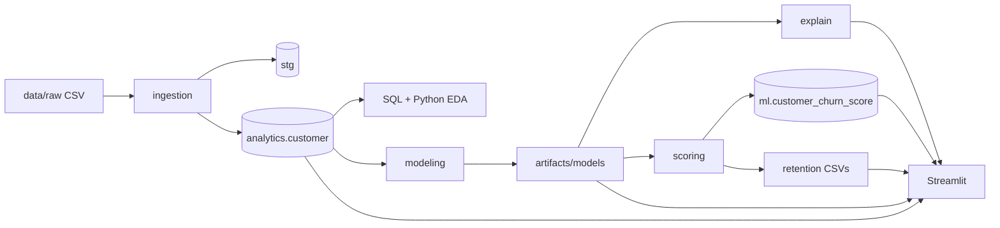

# AI-Powered Customer Churn Prediction & Retention Intelligence

End-to-end portfolio project: **SQL Server** data platform, **Python** analytics and machine learning, **SHAP** explainability, rule-based **retention intelligence**, and a **Streamlit** dashboard for telco-style customer churn.

> Local demonstration — not production deployment, not proven ROI, not real-time scoring.

**Quick links:** [Documentation index](docs/README.md) · [Setup](docs/SETUP_GUIDE.md) · [SQL scripts](docs/SQL_GUIDE.md) · [Python modules](docs/PYTHON_GUIDE.md) · [Architecture](docs/ARCHITECTURE.md)

---

## Business problem and motivation

Churn reduces recurring revenue. Teams need to understand historical churn patterns, estimate risk on the current base, explain model drivers (carefully), and prioritize outreach — with reproducible SQL + Python workflows.

## Business objectives

| Objective | Deliverable in this repo |
|-----------|---------------------------|
| Governed customer data | Validated ingest → `analytics.customer` |
| Segment insight | SQL EDA + Python EDA |
| Predictive baseline | Three models; logistic regression selected |
| Transparency | Global SHAP (log-odds) |
| Actionable lists | High-risk flag + recommendation rules |
| Stakeholder demo | Six-page Streamlit dashboard (read-only) |

## Key features (implemented)

- CSV validation and **append-only** staging history
- Analytics mart refresh with **reject table** for bad rows
- Nine SQL EDA scripts + Python EDA plots
- Baseline **Dummy / Logistic Regression / Random Forest** comparison
- Batch scoring to **`ml.customer_churn_score`** (append-only) + CSV
- Retention analysis at **75th percentile** risk threshold
- Dashboard KPIs separating **observed churn**, **predicted churn @ 0.5**, and **high-risk**

## Technology stack

| Area | Tools |
|------|--------|
| Database | Microsoft SQL Server, T-SQL |
| Connectivity | SQLAlchemy, pyodbc, ODBC Driver 18 |
| Python | 3.11+ (developed on 3.14), pandas, scikit-learn |
| Explainability | SHAP (`LinearExplainer`) |
| Viz / UI | Matplotlib, Seaborn, Plotly, Streamlit |
| Tests | pytest |

## System architecture



Details: [docs/ARCHITECTURE.md](docs/ARCHITECTURE.md)

## Dashboard screenshot gallery

Static captures of the six Streamlit pages (for portfolio viewers; paths work on GitHub if these files are committed):

| Page | Screenshot |
|------|------------|
| Executive Overview | [docs/screenshots/01-executive-overview.png](docs/screenshots/01-executive-overview.png) |
| Churn Analytics | [docs/screenshots/02-churn-analytics.png](docs/screenshots/02-churn-analytics.png) |
| Churn Risk | [docs/screenshots/03-churn-risk.png](docs/screenshots/03-churn-risk.png) |
| Model Performance | [docs/screenshots/04-model-performance.png](docs/screenshots/04-model-performance.png) |
| SHAP Explainability | [docs/screenshots/05-shap-explainability.png](docs/screenshots/05-shap-explainability.png) |
| Retention Intelligence | [docs/screenshots/06-retention-intelligence.png](docs/screenshots/06-retention-intelligence.png) |

Screenshots reflect a **past local run**; KPIs may differ if you reload data or rescore. Interactive behavior is not validated by PNGs alone.

**EDA and SHAP plot files** from batch jobs live under `artifacts/eda/` and `artifacts/explainability/` (gitignored — regenerate with `python -m churn_intel.analytics` and `python -m churn_intel.explain` after setup).

## Dataset

IBM Telco Customer Churn ([Kaggle](https://www.kaggle.com/datasets/blastchar/telco-customer-churn)) — **not redistributed**. Place at `data/raw/WA_Fn-UseC_-Telco-Customer-Churn.csv`.

Profile: [docs/DATASET_PROFILE.md](docs/DATASET_PROFILE.md). Reference counts from saved model metadata (`artifacts/models/baseline_model_metadata.json`, local file): **7,043** customers; **26.54%** churn prevalence; **11** blank `TotalCharges` at tenure 0.

## SQL Server data model

| Schema | Role |
|--------|------|
| `stg` | Raw ingested batches |
| `analytics` | Curated `customer` mart + `dq_load_reject` |
| `ml` | `model_registry`, append-only `customer_churn_score` |
| `retention` | Schema reserved; Phase 5 outputs primarily CSV |

Script inventory: [docs/SQL_GUIDE.md](docs/SQL_GUIDE.md) · [sql/README.md](sql/README.md)

## Machine learning workflow

1. Load mart from SQL → stratified 80/20 split (`seed=42`).
2. Preprocess numeric + categorical → **46** encoded features.
3. Compare three baselines; select **logistic_regression_balanced** by test **PR-AUC 0.659**.
4. Save pipeline to `artifacts/models/`.
5. Optional: SHAP global explain → `artifacts/explainability/`.
6. Optional: batch score → SQL + CSV.

Full detail: [docs/MODEL_DOCUMENTATION.md](docs/MODEL_DOCUMENTATION.md)

## Model evaluation (held-out test)

| Model | PR-AUC | ROC-AUC | Recall (churn) | Precision (churn) |
|-------|--------|---------|----------------|-------------------|
| Dummy stratified | 0.272 | 0.516 | 0.291 | 0.289 |
| **Logistic regression** | **0.659** | **0.843** | **0.783** | **0.507** |
| Random forest | 0.608 | 0.825 | 0.634 | 0.572 |

Source: `artifacts/evaluation/baseline_metrics_comparison.csv` (local artifact; rounded to three decimals in the table above).

## Explainability (SHAP)

Global SHAP for the selected linear model; **log-odds** scale; feature count aligned with pipeline (**46**). Association only — not causal. [docs/SHAP_EXPLAINABILITY_REPORT.md](docs/SHAP_EXPLAINABILITY_REPORT.md)

## Retention intelligence

- **High-risk:** probability ≥ 75th percentile within scored population (separate from **0.5** label threshold).
- Rule-based recommendations for high-risk profiles only (contract, tenure, security, support, payment).
- [docs/RETENTION_INTELLIGENCE.md](docs/RETENTION_INTELLIGENCE.md)

## Dashboard

Six pages: Executive Overview, Churn Analytics, Churn Risk, Model Performance, SHAP, Retention Intelligence.

```powershell
$env:PYTHONPATH = "src"
python -m streamlit run src/churn_intel/dashboard/app.py
```

Guide: [docs/DASHBOARD_GUIDE.md](docs/DASHBOARD_GUIDE.md)

## Project structure

```text
├── README.md                 # This file
├── requirements.txt
├── .env.example              # Safe template (copy to .env)
├── docs/                     # Guides + phase reports
├── sql/                      # DDL, DML, analytics SQL
├── src/churn_intel/          # Application package
├── tests/                    # pytest unit + integration
├── scripts/                  # SQL EDA runner, diagnostics
├── data/raw|processed/       # Local data (gitignored)
└── artifacts/                # Models, metrics, plots (gitignored)
```

There is no separate `reports/` folder; reports live under `docs/` and `artifacts/evaluation/`.

## Installation and execution

See **[docs/SETUP_GUIDE.md](docs/SETUP_GUIDE.md)** for virtualenv, `.env`, database creation, and commands.

Minimal path:

```powershell
cd <project-root>
python -m pip install -r requirements.txt
copy .env.example .env
# edit .env — use your server name, not a shared credential
$env:PYTHONPATH = "src"
python -m churn_intel.connection_check
python -m streamlit run src/churn_intel/dashboard/app.py
```

**Commands that write data** (run intentionally): `churn_intel.ingestion`, `churn_intel.scoring`, `churn_intel.modeling`, `churn_intel.explain`, `churn_intel.retention`, `churn_intel.analytics`.

## Tests

```powershell
python -m pytest -m "not integration" -v
```

Integration tests append staging batches when enabled. [tests/README.md](tests/README.md)

## Current limitations

- Single snapshot dataset; no temporal validation.
- Append-only score history requires “latest batch” logic in the dashboard.
- SHAP and metrics are precomputed artifacts, not live on every refresh.
- Retention recommendations are hypotheses, not A/B tested interventions.
- SQL required for customer mart; scores can fall back to CSV.

## Future improvements (not implemented)

- Time-based validation and monitoring hooks
- Persist retention summaries in `retention` schema tables
- CI with dockerized SQL or mocked DB layer
- Refresh `docs/screenshots/` after major dashboard changes

## Privacy and data handling

- `.gitignore` excludes `.env`, raw/processed data, `artifacts/`, and root CSV.
- Do not commit customer-level exports or secrets.
- Review [data/README.md](data/README.md) before any public upload.

## Documentation map

| Guide | Topic |
|-------|--------|
| [docs/PROJECT_OVERVIEW.md](docs/PROJECT_OVERVIEW.md) | Executive summary |
| [docs/ARCHITECTURE.md](docs/ARCHITECTURE.md) | Data flow and schemas |
| [docs/SQL_GUIDE.md](docs/SQL_GUIDE.md) | All SQL files |
| [docs/PYTHON_GUIDE.md](docs/PYTHON_GUIDE.md) | Modules and CLI |
| [docs/MODEL_DOCUMENTATION.md](docs/MODEL_DOCUMENTATION.md) | ML details |
| [docs/DASHBOARD_GUIDE.md](docs/DASHBOARD_GUIDE.md) | UI and KPIs |
| [docs/TROUBLESHOOTING.md](docs/TROUBLESHOOTING.md) | Common fixes |

---

Portfolio / educational use. Respect Kaggle dataset terms. No affiliation with IBM or Kaggle implied.
