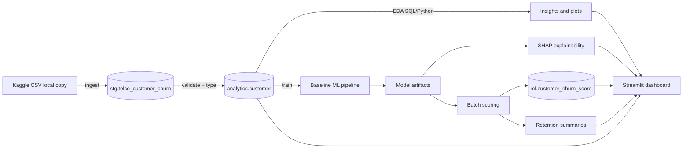

# AI-Powered Customer Churn Prediction & Retention Intelligence

Portfolio-grade end-to-end analytics and machine learning project for **telco customer churn**: SQL Server data platform, Python EDA, baseline classification, SHAP explainability, retention intelligence, and a Streamlit demo dashboard.

**Status:** Phases 1–6 implemented; Phase 7 quality audit completed (see consistency checks below).

---

## Problem and motivation

Customer churn erodes recurring revenue. This project demonstrates how a data team can:

1. Land and validate customer data in **Microsoft SQL Server**.
2. Explore churn drivers with **SQL and Python**.
3. Train and compare **baseline ML models** on a curated analytics table.
4. Explain predictions with **SHAP** (associational, not causal).
5. Prioritize retention outreach with **transparent rules** (no fabricated ROI).
6. Present results in an **interactive dashboard** for stakeholders.

This is a **local portfolio demonstration**, not a production deployment.

---

## Architecture and data flow



**Schemas:** `stg`, `analytics`, `ml`, `retention` (see `sql/ddl/`).

---

## Technology stack

| Layer | Tools |
|-------|--------|
| Database | Microsoft SQL Server, T-SQL |
| Connectivity | SQLAlchemy, pyodbc, ODBC Driver 18 |
| Python | 3.14+ (3.11+ compatible), pandas, scikit-learn |
| Explainability | SHAP (`LinearExplainer` for logistic regression) |
| Visualization | Matplotlib, Seaborn, Plotly, Streamlit |
| Testing | pytest |

---

## Dataset (not redistributed)

IBM Telco Customer Churn from Kaggle — **not committed** to Git.

1. Download from [Kaggle: Telco Customer Churn](https://www.kaggle.com/datasets/blastchar/telco-customer-churn).
2. Copy to `data/raw/WA_Fn-UseC_-Telco-Customer-Churn.csv`.
3. Do not commit raw CSV, `.env`, or local `data/processed/` outputs.

**Verified snapshot (SQL `analytics.customer`, audit 2026-10-14):**

| Metric | Value |
|--------|--------|
| Customers | 7,043 |
| Observed churn Yes / No | 1,869 / 5,174 |
| Historical churn rate | 26.54% |
| NULL `TotalCharges` (tenure=0 pattern) | 11 |

---

## Key EDA findings (associational)

From [docs/EDA_BUSINESS_INSIGHTS.md](docs/EDA_BUSINESS_INSIGHTS.md) (SQL-backed):

- **Month-to-month** contracts: 42.7% observed churn (n=3,875).
- **Tenure 0–12 months:** 47.4% observed churn (n=2,186).
- **Electronic check** payment: 45.3% observed churn (n=2,365).
- **Fiber optic** internet: 41.9% observed churn (n=3,096).

These describe historical patterns in the sample — **not causal effects**.

---

## Baseline modeling (held-out test set)

Trained from `analytics.customer` with stratified 80/20 split (`random_state=42`).

| Model | Accuracy | Precision (churn) | Recall (churn) | F1 | ROC-AUC | PR-AUC |
|-------|----------|-------------------|----------------|-----|---------|--------|
| Dummy (stratified) | 0.622 | 0.289 | 0.291 | 0.290 | 0.516 | 0.272 |
| **Logistic Regression (balanced)** | **0.740** | **0.507** | **0.783** | **0.616** | **0.843** | **0.659** |
| Random Forest (balanced) | 0.777 | 0.572 | 0.634 | 0.602 | 0.825 | 0.608 |

**Selected model:** Logistic Regression — highest **PR-AUC** on the test set (important for imbalanced churn). Higher **recall** (0.783) vs Random Forest with lower precision — a conscious trade-off for flagging at-risk customers at threshold **0.5**.

Artifacts: `artifacts/models/baseline_churn_pipeline.joblib`, `artifacts/evaluation/baseline_metrics_comparison.csv`.

Report: [docs/BASELINE_MODEL_REPORT.md](docs/BASELINE_MODEL_REPORT.md)

---

## SHAP and retention (Phase 5)

- **SHAP scale:** log-odds for churn class; **46** encoded features aligned with the fitted pipeline.
- Top global |SHAP| features (executed): tenure, TotalCharges, MonthlyCharges, month-to-month contract, fiber optic.
- **High-risk retention rule:** predicted probability ≥ **75th percentile** (~**0.701**, **1,761** customers in last verified run) — **separate** from the **0.5** model label threshold.
- Recommendations are **hypotheses** for testing; ROI/CLV **not** estimated.

Docs: [docs/SHAP_EXPLAINABILITY_REPORT.md](docs/SHAP_EXPLAINABILITY_REPORT.md), [docs/RETENTION_INTELLIGENCE.md](docs/RETENTION_INTELLIGENCE.md)

---

## Dashboard (Phase 6)

Six pages: Executive Overview, Churn Analytics (observed churn), Churn Risk (predicted + high-risk), Model Performance, SHAP, Retention Intelligence.

```powershell
$env:PYTHONPATH = "src"
python -m streamlit run src/churn_intel/dashboard/app.py
```

Details: [docs/STREAMLIT_DASHBOARD.md](docs/STREAMLIT_DASHBOARD.md). **Read-only** — no training or score writes on startup.

---

## Setup

```powershell
cd <project-root>
python -m pip install -r requirements.txt
copy .env.example .env
# Edit .env: CHURN_DB_SERVER, CHURN_DB_NAME=ChurnIntel, CHURN_DB_AUTH=windows, etc.
```

Create database once in SSMS: `CREATE DATABASE ChurnIntel;`

Connection test:

```powershell
$env:PYTHONPATH = "src"
python -m churn_intel.connection_check
```

---

## Reproducible commands (by phase)

| Step | Command | DB side effects |
|------|---------|-----------------|
| Validate CSV | `python -c "..."` (see `docs/DATASET_PROFILE.md`) | None |
| Ingest | `python -m churn_intel.ingestion` | Appends staging batch; refreshes `analytics.customer` |
| SQL EDA export | `python scripts/run_sql_eda.py` | Read-only |
| Python EDA | `python -m churn_intel.analytics` | Read-only |
| Train baselines | `python -m churn_intel.modeling` | Read-only |
| SHAP global | `python -m churn_intel.explain` | Read-only |
| Batch score | `python -m churn_intel.scoring` | **Appends** `ml.customer_churn_score` rows |
| Retention | `python -m churn_intel.retention` | Read-only |
| Dashboard | `python -m streamlit run src/churn_intel/dashboard/app.py` | Read-only |

Set `$env:PYTHONPATH = "src"` for all Python module commands.

---

## Tests

```powershell
python -m pytest -m "not integration" -v
```

**Phase 7 run:** 28 passed, 1 deselected (integration).

Integration test (`CHURN_DB_INTEGRATION=1`) runs full ingestion and **appends a staging batch** — use intentionally:

```powershell
$env:CHURN_DB_INTEGRATION = "1"
python -m pytest -m integration -v
```

---

## Output locations

| Content | Path |
|---------|------|
| EDA plots | `artifacts/eda/` |
| Model + metadata | `artifacts/models/` |
| Evaluation metrics | `artifacts/evaluation/` |
| SHAP plots/CSV | `artifacts/explainability/` |
| Processed tables/CSVs | `data/processed/` (gitignored) |
| Reports | `docs/` |

---

## Privacy and Git hygiene

`.gitignore` excludes: `.env`, `data/raw/`, `data/processed/`, `*.csv` (except under `docs/`), `artifacts/`, `*.joblib`.

Do **not** commit customer-level score CSVs or credentials. Dashboard default views omit `customerID`.

**Git:** not detected on PATH in Phase 7 audit; no repository initialized in this project folder. Initialize Git locally before manual GitHub review.

---

## Known limitations

- Sample telco dataset; associations ≠ causation.
- Not production-hardened (monitoring, auth, SLAs, MLOps).
- Append-only score history requires **latest timestamp** selection in the dashboard.
- SHAP artifacts are precomputed (log-odds); live SHAP not recomputed on each dashboard refresh.
- Re-running ingestion/scoring/integration tests mutates staging/score history.

---

## Documentation index

- [docs/PROJECT_PLAN.md](docs/PROJECT_PLAN.md)
- [docs/DATASET_PROFILE.md](docs/DATASET_PROFILE.md)
- [docs/EDA_BUSINESS_INSIGHTS.md](docs/EDA_BUSINESS_INSIGHTS.md)
- [docs/BASELINE_MODEL_REPORT.md](docs/BASELINE_MODEL_REPORT.md)
- [docs/SHAP_EXPLAINABILITY_REPORT.md](docs/SHAP_EXPLAINABILITY_REPORT.md)
- [docs/RETENTION_INTELLIGENCE.md](docs/RETENTION_INTELLIGENCE.md)
- [docs/STREAMLIT_DASHBOARD.md](docs/STREAMLIT_DASHBOARD.md)

---

## License

Portfolio / educational use. Respect Kaggle dataset terms. No affiliation with IBM or Kaggle implied.
