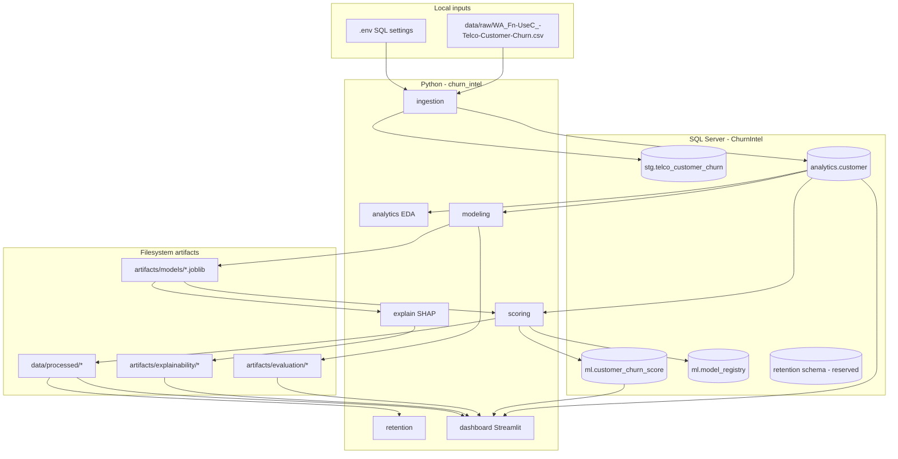

# Architecture

## High-level data flow

## Schema roles

| Schema | Purpose |
|--------|---------|
| `stg` | Append-only landing for each ingestion batch (`stg.telco_customer_churn`) |
| `analytics` | Curated customer mart (`analytics.customer`) and view `analytics.v_customer_churn` |
| `ml` | Model registry and append-only score history (`ml.customer_churn_score`) |
| `retention` | Schema created for future retention tables; Phase 5 retention outputs are primarily **CSV** under `data/processed/retention/` |

## Component communication

- **Python → SQL Server:** SQLAlchemy + pyodbc (`churn_intel.db`, `churn_intel.config`).
- **Ingestion:** Validates CSV in memory, bulk-inserts staging, runs DML to refresh `analytics.customer` for the new batch.
- **Modeling:** Reads `analytics.customer` via pandas/SQL; writes **joblib** and evaluation CSVs only (no score table writes).
- **Scoring:** Loads fitted pipeline from disk; **appends** score rows to SQL and writes `data/processed/retention/customer_churn_scores.csv`.
- **Dashboard:** Read-only queries to `analytics.customer` and `ml.customer_churn_score`; reads static CSV/PNG artifacts for metrics, SHAP, and retention summaries.

## SQL vs CSV fallback

| Data | Primary source | Fallback |
|------|----------------|----------|
| Customer attributes | SQL `analytics.customer` | None — dashboard stops if SQL fails |
| Churn scores | SQL latest `scored_at_utc` batch | `data/processed/retention/customer_churn_scores.csv` |
| Model metrics | `artifacts/evaluation/baseline_metrics_comparison.csv` | — |
| SHAP | `artifacts/explainability/global_feature_importance.csv` + PNGs | — |
| Retention summaries | `data/processed/retention/*.csv` | — |

Toggle **“Load scores from SQL Server”** in the dashboard sidebar to force SQL vs allow CSV fallback behavior (see [DASHBOARD_GUIDE.md](DASHBOARD_GUIDE.md)).

## Important paths

| Path | Role |
|------|------|
| `sql/ddl/` | One-time / idempotent schema and table creation |
| `sql/dml/` | Refresh analytics mart from staging |
| `sql/analytics/eda/` | Read-only analytical SELECT scripts |
| `artifacts/models/baseline_churn_pipeline.joblib` | Fitted sklearn pipeline |
| `artifacts/models/baseline_model_metadata.json` | Training metadata and feature lists |

## Explainability module name

The Python package uses `churn_intel.explain` (not `explainability/`). This matches imports in scoring and tests.
